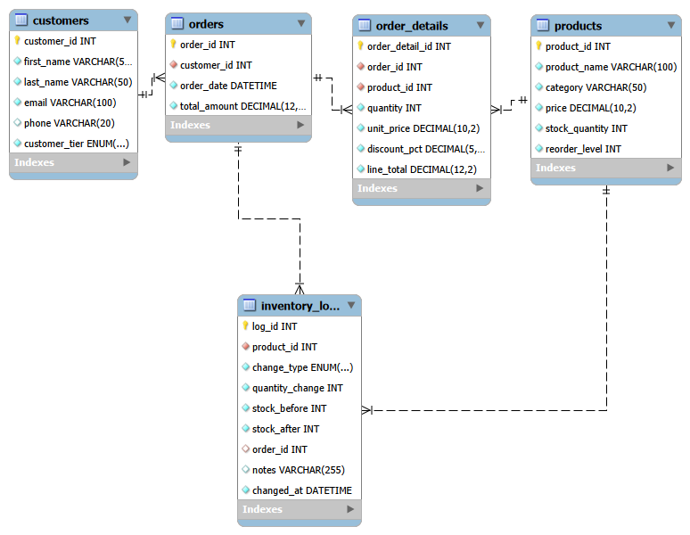

# Inventory & Order Management System

**Author:** David Kamanda
**Database:** MySQL 8 (built and tested in MySQL Workbench)

A database-driven system for an e-commerce company that manages products,
customers and orders, keeps stock levels accurate automatically, records
every inventory change for auditing, and produces business reports.

---

## How to run

Run the scripts **in this order** in MySQL Workbench (open each file, then
click the lightning bolt with nothing selected):

| # | File | What it does |
|---|------|--------------|
| 1 | `phase1_schema.sql` | Creates a fresh database: 5 tables, constraints, indexes |
| 2 | `phase2_orders.sql` | Sample data, order triggers, `place_order` procedure, tracking queries |
| 3 | `phase3_reports.sql` | Order summaries, low-stock, tier and discount reports |
| 4 | `phase4_replenishment.sql` | Replenishment procedures, automatic customer tiers |
| 5 | `phase5_views.sql` | Views, performance optimization and evidence |

Phase 2 and Phase 4 end with **failure tests** that are *supposed* to fail.
Workbench stops at the first one; run the rest one at a time (Ctrl + Enter).

To start again from scratch, rerun `phase1_schema.sql` (it drops and recreates the database).

---

## Database design



| Table | Purpose |
|-------|---------|
| `products` | Product ID, name, category, price, stock quantity, reorder level |
| `customers` | Customer ID, name, email (unique), phone (optional), tier |
| `orders` | One row per order: customer, date, total amount |
| `order_details` | One row per product in an order: quantity, unit price, discount, line total |
| `inventory_logs` | Audit trail of every stock change (orders and replenishments) |

**Data integrity**
- Primary keys on every table; foreign keys link orders → customers,
  order_details → orders/products, inventory_logs → products/orders.
- CHECK constraints: no negative prices, stock, totals or quantities;
  discount between 0 and 100; a log change can't be 0.
- UNIQUE: product names, customer emails, one line per product per order.
- Delete rules: customers and sold products cannot be deleted (history is kept);
  deleting an order removes its lines (CASCADE); log rows are kept (SET NULL).
- `unit_price` is copied into `order_details` at the time of sale, so old orders
  keep their original price if a product's price changes later.

---

## Business rules

| Rule | Value |
|------|-------|
| Low stock | `stock_quantity < reorder_level` |
| Replenishment target | refill to **2 × reorder level** |
| Bulk discount (per product line) | 20–49 units = **5%**, 50+ units = **10%** |
| Customer tiers (total spent) | **Gold** ≥ 5,000 · **Silver** ≥ 1,500 · **Bronze** < 1,500 |

---

## Database objects

| Type | Name | Purpose |
|------|------|---------|
| Trigger | `trg_order_details_before_insert` | Checks product exists and stock is enough; sets price, bulk discount, line total |
| Trigger | `trg_order_details_after_insert` | Deducts stock, writes inventory log, adds line total to order total |
| Trigger | `trg_orders_after_update` | Recalculates the customer's tier whenever an order total changes |
| Procedure | `place_order(customer_id, items_json)` | Places a whole multi-product order in one transaction (all or nothing) |
| Procedure | `replenish_product(product_id, qty, notes)` | Restocks one product and logs it |
| Procedure | `replenish_low_stock()` | Restocks every low product to 2 × reorder level and logs each one |
| Procedure | `refresh_customer_tier(customer_id)` | Tier rules in one place (used by the trigger) |
| View | `vw_order_summary` | Customer name, order date, total, number of products/items per order |
| View | `vw_low_stock` | Products below reorder level with shortfall, suggested quantity, cost |
| View | `vw_customer_spending` | Orders, total spent, average order and tier per customer (bonus) |

Example order with two products:

```sql
CALL place_order(1, '[{"product_id": 1, "quantity": 1}, {"product_id": 2, "quantity": 2}]');
```

---

## What is automated

| Process | How |
|---------|-----|
| Stock deducted after an order | `trg_order_details_after_insert` |
| Order total calculated | both `order_details` triggers |
| Bulk discount applied | `trg_order_details_before_insert` |
| Every stock change logged | order trigger + both replenish procedures |
| Low stock refilled | `CALL replenish_low_stock();` (one command, safe to run repeatedly) |
| Customer tier updated | `trg_orders_after_update` after every order |
| Failed orders leave no trace | transactions with ROLLBACK in `place_order` |

---

## Performance optimization

| Optimization | Evidence |
|--------------|----------|
| Indexes on columns used for searching/joining (plus automatic PK/FK indexes) | `EXPLAIN` on real tables shows `type = ref` |
| Index benefit measured on 200,000 rows | `ALL` (~200,000 rows) → `ref` (~20 rows), about 100× faster |
| Date filters written as ranges, not `YEAR()`/`MONTH()` | `index` (~200,000 rows) → `range` (~8,500 rows) |
| Generated column `is_low_stock` + index | low-stock search `ALL` → `ref` |
| Removed an index that could not help | less overhead on every stock change |
| Set-based statements instead of loops | one statement restocks/inserts many rows |
| Views | consistent, simple access to common reports |

---

## Key findings (sample data)

- **One Gold customer** (David) brings in the largest share of revenue.
- **Levy** was upgraded Bronze → Silver **automatically** after placing an order.
- **Bulk discounts** cost only **0.67%** of gross sales (76.37 of 11,467.50 in Phase 3).
- **Low stock** (Monitor, Standing Desk, HDMI Cable) was detected and refilled with
  one command; every change is visible in `inventory_logs`.
- Failed orders (out of stock, unknown customer/product, zero quantity) were
  **fully rolled back**: no partial orders, no stock or tier changes.